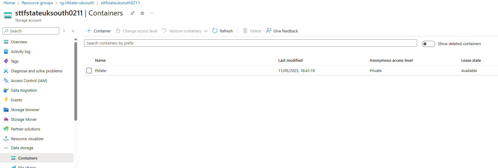
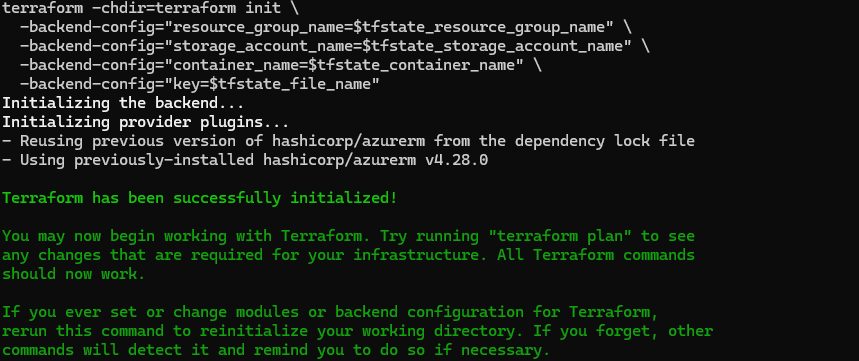
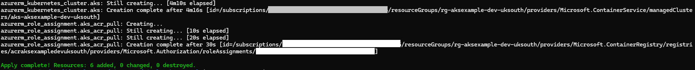
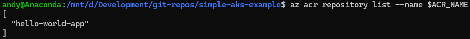
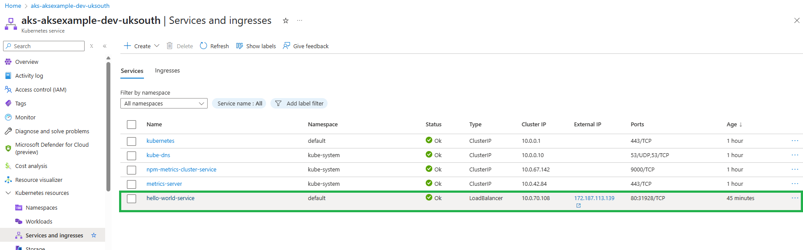
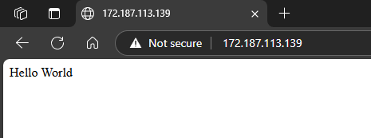

# Simple AKS Example

This repo contains the code to deploy a simple Azure Kubernetes Service cluster using Terraform, and present a "Hello World" Python-based web application.

You will need to be owner of a subscription if you would like to create all the resources this guide will walk you through.

> Disclaimer: Please remember to clean-up any resources you deploy whilst following this guide, to avoid any unwanted Azure costs.

All steps were carried out using a Windows 11 PC - your mileage may vary.

## Prerequisites

Software used during this process:

- Azure CLI:
  ```PowerShell
  winget install -e --id Microsoft.AzureCLI
  ```

- Terraform
  ```PowerShell
  winget install -e --id Hashicorp.Terraform
  ```

- KubeCTL
  ```PowerShell
  winget install -e --id Kubernetes.kubectl
  ```

- Docker Desktop
  ```PowerShell
  winget install -e --id Docker.DockerDesktop
  ```

For more information on setting up your PC to run this code, here is a Microsoft Learn guide - [Install Terraform on Windows with Bash](https://learn.microsoft.com/en-us/azure/developer/terraform/get-started-windows-bash)

### A Note on Using WSL

If you're using WSL with Ubuntu, you may need to install these snap packages:

```bash
sudo snap install terraform --classic
sudo snap install kubectl --classic
```

That said, I did struggle to get kubectl working in WSL - it could not contact the relay running on my PC it needed to access the AKS API. In the end I used KubeCTL with PowerShell.

## Setup

Log into Azure:

```bash
az login
```

Create environment variables to use with the deployment:

```bash
# Terraform State resources (backend)
tfstate_resource_group_name="rg-tfstate-uksouth"
tfstate_location="uksouth"
# Storage account names must be globally unique (3-24 lowercase letters and digits), so append a
# stable 6-character hash of your subscription ID - the same name results every time you run this
subscription_hash=$(az account show --query id -o tsv | tr -d '\r\n' | sha256sum | cut -c1-6)
tfstate_storage_account_name="sttfstateuksouth${subscription_hash}"
tfstate_container_name="tfstate"
tfstate_file_name="aks-example-dev.tfstate"
```

Create a Storage Account for holding TF State:

```bash
# Create resource group
az group create --name $tfstate_resource_group_name --location $tfstate_location

# Create a secure Storage Account
az storage account create \
  --name $tfstate_storage_account_name \
  --resource-group $tfstate_resource_group_name \
  --location $tfstate_location \
  --sku Standard_LRS \
  --kind StorageV2 \
  --https-only true \
  --default-action Deny \
  --bypass AzureServices

# Create a network rule so only you can access the storage account
my_ip_address=$(curl https://api.ipify.org)
az storage account network-rule add \
  --account-name $tfstate_storage_account_name \
  --resource-group $tfstate_resource_group_name \
  --ip-address $my_ip_address

# Grant yourself data-plane access to the blobs (being Owner is not enough - it only covers the management plane)
storage_account_id=$(az storage account show \
  --name $tfstate_storage_account_name \
  --resource-group $tfstate_resource_group_name \
  --query id -o tsv)
az role assignment create \
  --assignee $(az ad signed-in-user show --query id -o tsv) \
  --role "Storage Blob Data Contributor" \
  --scope $storage_account_id

# Create blob container - the role assignment can take a minute or two to take effect, so retry if this is denied
az storage container create \
  --name $tfstate_container_name \
  --account-name $tfstate_storage_account_name \
  --auth-mode login
```



Set the environment variables the AzureRM provider needs, and create your variables file:

```bash
# Set the Environment vars required by the AzureRM provider - Confirm with: printenv | grep ARM_
export ARM_SUBSCRIPTION_ID=$(az account show --query "id" -o tsv | sed 's/\r//')
export ARM_TENANT_ID=$(az account show --query "tenantId" -o tsv | sed 's/\r//')

# Create your variables file from the example and edit as required (it is gitignored)
cp terraform/terraform.tfvars.example terraform/terraform.tfvars
```

`terraform.tfvars` only holds the environment-specific values. Everything else (VM size, node counts, zones, network ranges and so on) has a default in `terraform/variables.tf`. This is the Terraform equivalent of a `.env` file next to a `docker-compose.yml`.

The Kubernetes version defaults to the current AKS default. To see what is available, or to pin a version by setting `aks_kubernetes_version`:

```bash
az aks get-versions --location uksouth --output table
```

No storage account key is needed: the Terraform backend authenticates with your `az login` identity (`use_azuread_auth` in `backend.tf`), using the Storage Blob Data Contributor role assigned above.

### Check VM availability and quota

The default node pool uses `Standard_B2s_v2` (Bsv2 family) across availability zones 1, 2 and 3. New VM families often have a quota of zero on a subscription, so check before deploying:

```bash
# Is the size available in your region and zones? Restrictions should be None
az vm list-skus --location uksouth --size Standard_B2s_v2 --zone --output table

# Do you have quota? You need 2 vCPUs per node, so 4 for the autoscaler maximum of 2 nodes
az vm list-usage --location uksouth --query "[?contains(name.value,'standardBsv2Family')]" --output table
```

If the quota limit is 0, request an increase in the Azure Portal under Subscriptions > Usage + quotas, searching for "Bsv2". 

Some subscriptions are not enabled for zones on newer VM families. If you see zone restrictions, either request zonal access from Microsoft or deploy without zones by adding this to `terraform.tfvars`:

```hcl
aks_default_node_pool_availability_zones = []
```

## Deployment

Initialize Terraform:

```bash
# Initialize Terraform and download AzureRM provider
terraform -chdir=terraform init \
  -backend-config="resource_group_name=$tfstate_resource_group_name" \
  -backend-config="storage_account_name=$tfstate_storage_account_name" \
  -backend-config="container_name=$tfstate_container_name" \
  -backend-config="key=$tfstate_file_name"
```


Create an add/change plan:

```bash
# Create a plan of the resources to add/change
terraform -chdir=terraform  plan -out aks-example-dev.tfplan
```

Apply the add/change plan:

```bash
# Add/change the resources covered in the plan
terraform -chdir=terraform  apply aks-example-dev.tfplan
```



> Note: The deployment should take around 5 minutes to complete

## AKS Inspection

```bash
# Read the names Terraform created
aks_cluster_name=$(terraform -chdir=terraform output -raw aks_cluster_name)
resource_group_name=$(terraform -chdir=terraform output -raw resource_group_name)

# Get overview using Azure CLI
az aks show \
  --name $aks_cluster_name \
  --resource-group $resource_group_name \
  --output table

# Get nodepools using Azure CLI
az aks nodepool list \
  --cluster-name $aks_cluster_name \
  --resource-group $resource_group_name \
  --output table

# Get Cluster credentials and set to current context
az aks get-credentials --name $aks_cluster_name --resource-group $resource_group_name

# List all k8s objects from Cluster Control plane
kubectl get all --all-namespaces
```

## Build and Deploy a Hello World App

Build the app locally using Docker:

```Bash
# Build the dockerfile for the hello world app locally
docker build -t hello-world-app .

# Run the Docker container locally - CTRL+C to quit
docker run -p 5000:5000 hello-world-app
```

Upload the Docker image to the ACR:

```bash
# Isolate the ACR for token replacement
export ACR_NAME=$(terraform -chdir=terraform output -raw acr_name)

# Login into the ACR using Entra/AAD auth
az acr login --name $ACR_NAME

# Tag the Docker image and confirm
docker tag hello-world-app $ACR_NAME.azurecr.io/hello-world-app:v1
docker image ls | grep hello

# Push the image to the ACR
docker push $ACR_NAME.azurecr.io/hello-world-app:v1

# Confirm the image has been uploaded
az acr repository list --name $ACR_NAME
```



Serve the Hello World app using AKS:

```bash
# Substitute tokens to create the deployment file - the ACR name needs to reflect what was deployed
envsubst < kube-manifests/01-deployment.template.yml > kube-manifests/01-deployment.yml
envsubst < kube-manifests/02-service.template.yml > kube-manifests/02-service.yml

# Publish the app using the yml files
kubectl apply -f kube-manifests/01-deployment.yml
kubectl apply -f kube-manifests/02-service.yml

# Confirm the pods, deployment and service
kubectl get pods
kubectl get deployment
kubectl get service
```

Here's a view from the Azure Portal for comparison:



Browse to the External-IP to see the Hello World app in all its (not) glory:



## Clean-up

You don't technically need to delete the app from AKS but here are the commands:

```bash
# Unpublish the app using the yml files
kubectl delete -f kube-manifests/02-service.yml
kubectl delete -f kube-manifests/01-deployment.yml
```

Use Terraform to destroy the resources it deployed.

Create destroy plan:

```bash
# Create a plan of the resources to destroy
terraform -chdir=terraform  plan -destroy -out aks-example-dev.tfplan
```

Apply the destroy plan:

```bash
# Destroy the resources covered in the plan
terraform -chdir=terraform  apply -destroy aks-example-dev.tfplan
```

> Note: If you're totally done with this example, remember to remove the Terraform state storage account and resource group.
